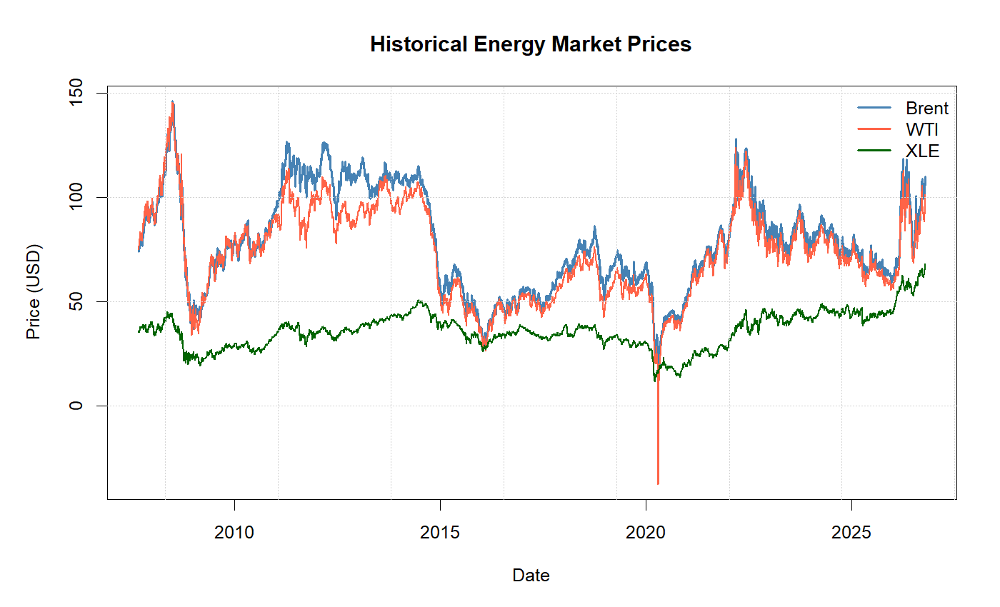
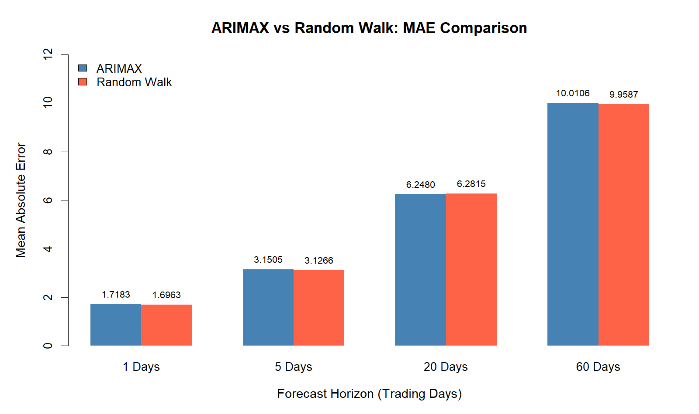
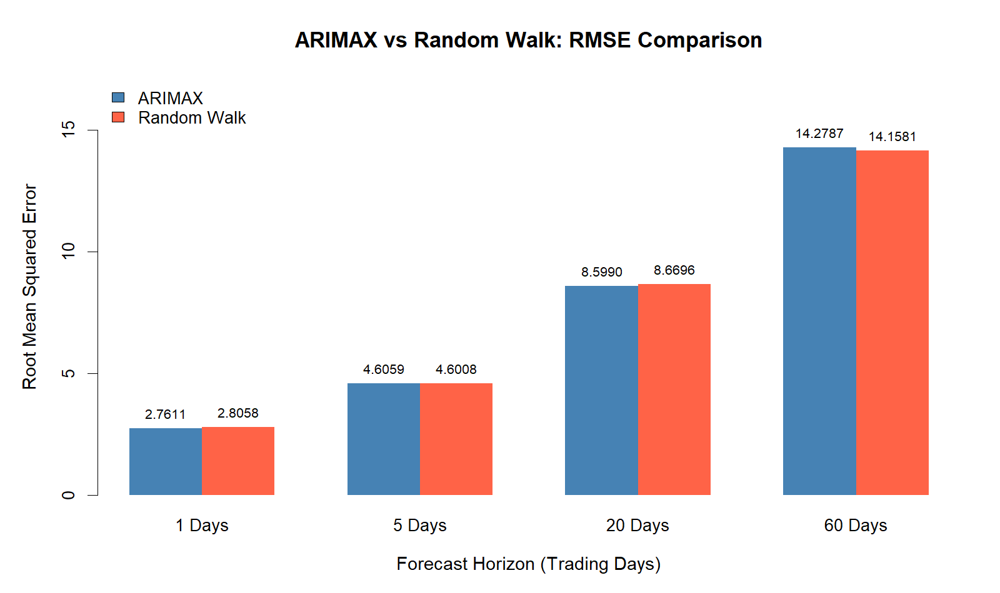
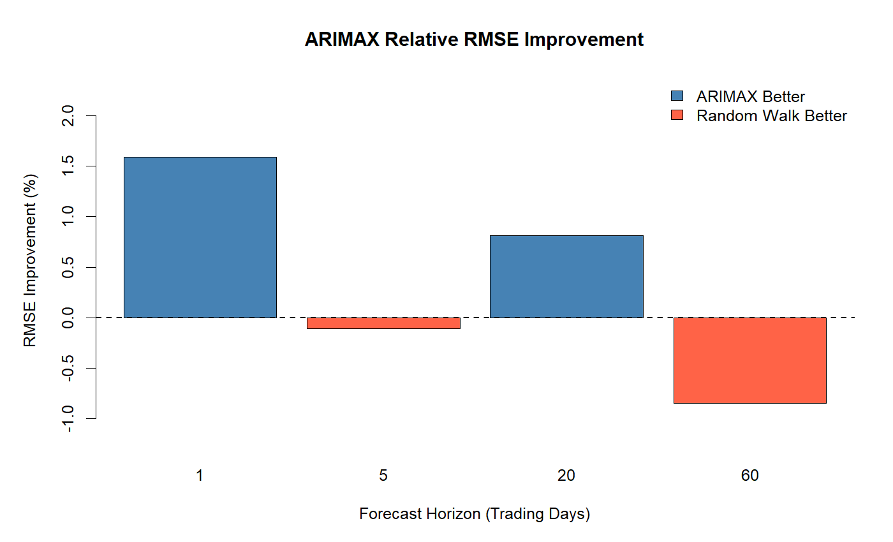
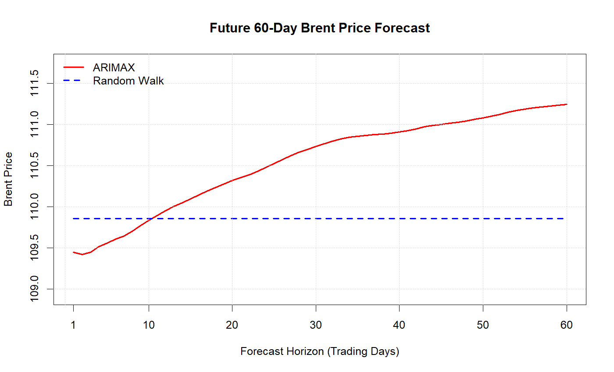

# Crude Oil Price Forecasting Using ARIMAX

### Multi-Horizon Time Series Forecasting and Rolling-Window Backtesting in R

## 1. Project Overview

This project develops a quantitative time-series forecasting framework for Brent crude oil prices using an Autoregressive Integrated Moving Average with Exogenous Variables (ARIMAX) model.

The framework incorporates WTI crude oil futures prices, the Energy Select Sector SPDR Fund (XLE), and historical Brent price dynamics to generate multi-horizon forecasts.

The forecasting performance is evaluated against a Random Walk benchmark through rolling-window out-of-sample backtesting.

## 2. Research Objectives

- Develop an ARIMAX-based forecasting framework for Brent crude oil prices.
- Investigate the predictive contribution of WTI, XLE, and historical Brent price changes.
- Generate forecasts across multiple investment horizons.
- Evaluate forecasting performance using rolling-window backtesting.
- Compare ARIMAX predictions with a Random Walk benchmark.

## 3. Dataset

Historical market data are retrieved from Yahoo Finance using the `quantmod` package in R.

| Variable | Yahoo Finance Ticker | Description |
|---|---|---|
| Brent Crude Oil | BZ=F | Brent crude oil futures |
| WTI Crude Oil | CL=F | West Texas Intermediate crude oil futures |
| XLE | XLE | Energy Select Sector SPDR Fund |

The dataset covers the period beginning in September 2007 and extending through October 2026.

Observations are aligned by trading date, and the resulting dataset is divided chronologically into:

- Training set: 70%
- Testing set: 30%

## 4. Methodology

### 4.1 ARIMAX Model

The forecasting framework models daily Brent price changes using an ARIMAX(3,0,0) specification.

The explanatory variables include:

- Daily changes in WTI crude oil prices.
- Daily changes in XLE prices.
- Lagged 60-trading-day Brent price changes.

WTI price changes are modeled using an AR(2) process, while XLE price changes are modeled using an AR(1) process.

These auxiliary forecasts are incorporated into a recursive forecasting procedure to generate future Brent price predictions.

### 4.2 Rolling-Window Backtesting

The project implements rolling-window out-of-sample backtesting with periodic parameter re-estimation.

| Parameter | Setting |
|---|---|
| Forecast horizons | 1, 5, 20, 60 trading days |
| Rolling-window size | 1,000 observations |
| Forecast-origin step | 10 trading days |
| Parameter re-estimation frequency | 20 trading days |
| Evaluation period | Chronological test dataset |

At each forecast origin, predictions are generated using historical observations available up to that point.

### 4.3 Random Walk Benchmark

A Random Walk model without drift, ARIMA(0,1,0), is implemented as the benchmark.

Under this specification, the forecasted future price equals the latest observed price.

The benchmark provides a reference for assessing whether the ARIMAX framework improves predictive accuracy.

## 5. Model Evaluation

Forecasting performance is assessed using:

- **MAE:** Mean Absolute Error.
- **RMSE:** Root Mean Squared Error.
- **MAPE:** Mean Absolute Percentage Error.
- **DA:** Directional Accuracy.

Directional Accuracy measures whether the predicted price movement has the same sign as the realized price movement over the corresponding forecast horizon.

For the no-drift Random Walk benchmark, directional accuracy is reported as not applicable because the model predicts zero price change.

## 6. Results and Visualizations

### Historical Energy Market Prices


### MAE Comparison


### RMSE Comparison


### Relative RMSE Improvement


### 60-Day Brent Price Forecast


## 7. Results and Discussion

The out-of-sample backtesting results demonstrate the practical applicability and competitive forecasting performance of the proposed ARIMAX forecasting framework in modeling Brent crude oil price dynamics across multiple forecast horizons.

The ARIMAX model achieves superior RMSE performance at the 1-day and 20-day forecast horizons, delivering improvements of approximately 1.59% and 0.81%, respectively, relative to the Random Walk benchmark. These results highlight the potential value of incorporating WTI crude oil prices, XLE market information, and historical Brent price dynamics into a multivariate forecasting framework.

Across all four forecast horizons, the ARIMAX model maintains forecasting accuracy closely comparable to the Random Walk benchmark, demonstrating competitive performance across short-, medium-, and longer-term prediction horizons. In particular, the improvements observed at selected horizons suggest that the inclusion of external market information can enhance predictive accuracy under certain forecasting conditions.

Furthermore, the model achieves directional accuracy of approximately 50%–53%, with its highest directional accuracy of 53.28% at the 60-day horizon.

Overall, the project demonstrates the practical application of ARIMAX modeling to energy-market forecasting and establishes a reproducible quantitative research framework that combines multivariate time-series analysis, benchmark comparison, and multi-horizon performance evaluation.

Future extensions could incorporate GARCH, VAR, and machine-learning-based forecasting methods to further explore predictive relationships and improve forecasting performance across different market regimes.

## 8. Repository Structure

```text
Crude-Oil-Price-Forecasting/
├── R/
│   ├── 01_Data_Preparation.R
│   ├── 02_Random_Walk.R
│   ├── 03_ARIMAX_model.R
│   ├── 04_Predict_60.R
│   └── 05_Visualizations.R
├── data/
│   ├── data.csv
│   ├── train.csv
│   └── test.csv
├── results/
│   ├── arimax_performance.csv
│   └── random_walk_performance.csv
├── figures/
│   ├── historical_prices.png
│   ├── mae_comparison.png
│   ├── rmse_comparison.png
│   ├── rmse_improvement.png
│   └── forecast_60_days.png
└── README.md
```

## 9. Implementation

**Programming Language:** R

**Key Packages:**

- `quantmod`
- `forecast`
- `tseries`
- `fBasics`
- `stats`

To reproduce the analysis, run the scripts from the repository root directory in the following order:

1. `01_Data_Preparation.R` — Download, clean, align, and split historical market data.
2. `02_Random_Walk.R` — Evaluate the Random Walk benchmark.
3. `03_ARIMAX_model.R` — Estimate the ARIMAX model and conduct rolling-window backtesting.
4. `04_Predict_60.R` — Generate and visualize 60-trading-day forecasts.

Ensure the required R packages are installed and the data paths are configured relative to the repository root.

## 10. Limitations and Future Extensions

Potential extensions include:

- Comparing ARIMAX with GARCH and VAR-based forecasting approaches.
- Investigating alternative lag structures and predictor specifications.
- Evaluating forecast performance across different market regimes.
- Extending the framework to machine-learning-based forecasting models.

## 11. Disclaimer

This project is intended for educational and quantitative research purposes only. Forecasts are not investment recommendations.
